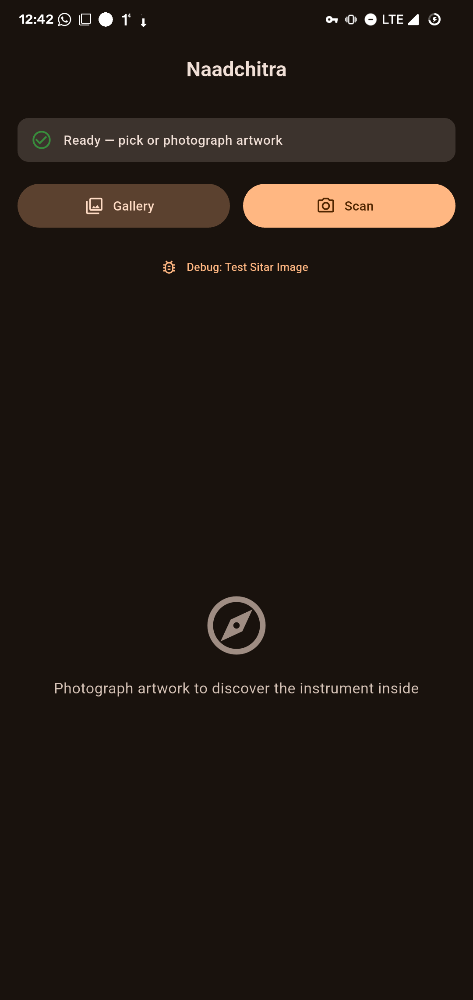
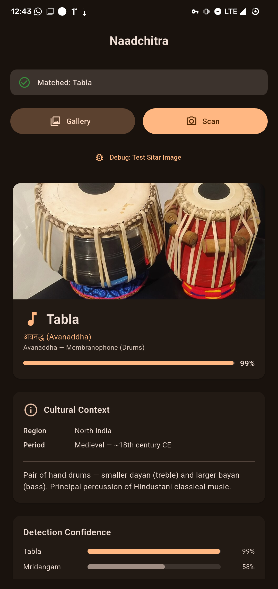
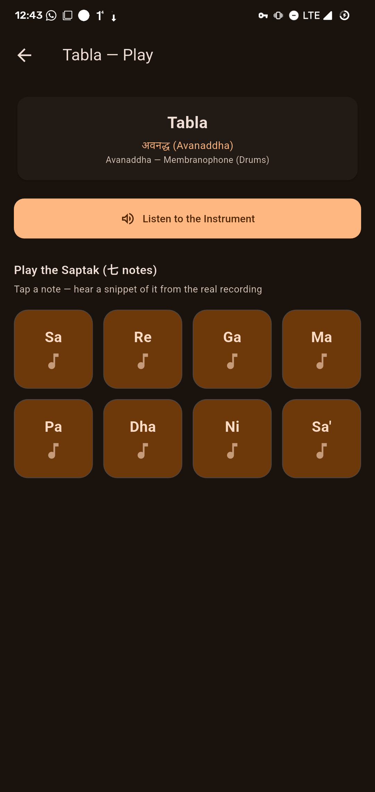

# Naadchitra 🎵

**Point your phone at a piece of Indian art. Hear the instrument inside it. Play it yourself.**

[](https://github.com/ayyogz/naadchitra/actions/workflows/build.yml)


Built for **Smart India Hackathon 2026 · Problem Statement SIH26197**, which asks for a way to showcase Indian cultural heritage.

<p align="center">
  
  
  
</p>

## What it does

1. **Photograph or pick** a painting, sculpture or print that shows a classical Indian instrument.
2. The app **identifies the instrument on the device itself**. No cloud, no internet, no account.
3. It shows a **cultural context card**: the Natya Shastra family, region and period.
4. It **plays the instrument's real recorded sound**, then lets you play it on a **Saptak pad** (Sa Re Ga Ma Pa Dha Ni Sa'). Each key plays a real one-second clip cut from that instrument's own recording, with no pitch-shifting.

### The five instruments

| Instrument | Natya Shastra family | Region |
|---|---|---|
| Sitar | तत (*tata*), string | North India |
| Saraswati Veena | तत (*tata*), string | Pan-Indian / South |
| Tabla | अवनद्ध (*avanaddha*), membrane | North India |
| Mridangam | अवनद्ध (*avanaddha*), membrane | South India |
| Bansuri | सुषिर (*sushira*), wind | Pan-Indian |

## Install

**Just want to try it?**

1. Open the [latest release](../../releases/latest).
2. Download **`app-arm64-v8a-release.apk`**. This is the right one for almost every phone made in the last 8 years. Very old 32-bit phones need `armeabi-v7a`.
3. On your phone, allow **Install unknown apps** for your browser or file manager, then open the APK.

Requires Android 8.0 (API 26) or newer. The app is a prototype and is signed with a debug key, so Android may show a warning.

## Build from source

You need three things: **Flutter** (stable channel, Dart ≥ 3.13.1), **JDK 21** and the **Android SDK**. The ML model, embeddings and audio are already committed, so you do **not** need Python to build the app.

```bash
git clone https://github.com/ayyogz/naadchitra.git
cd naadchitra
./setup.sh                                   # checks Flutter and runs `flutter pub get`

flutter run                                  # on a connected phone or emulator
flutter build apk --release --split-per-abi  # APKs land in build/app/outputs/flutter-apk/
```

Run `flutter doctor` first if anything complains. If Gradle fails with a `jlink` or `jdkImage` error, you are on a JDK that is too new for the Android Gradle Plugin. Point `JAVA_HOME` at JDK 21.

Every `v*` tag also builds and attaches the APKs automatically through GitHub Actions (`.github/workflows/build.yml`).

## How it works

```
photo ─► resize 224×224, normalise ─► MobileNetV3-Small (ONNX Runtime, on device)
      ─► 576-d embedding ─► cosine similarity vs 5 per-instrument reference embeddings
      ─► best match (below 0.50 similarity = "no instrument found") ─► card + audio
```

- **No training.** Each instrument is represented by the mean embedding of 23 reference photos from Wikimedia Commons, computed with the exact same ONNX model that runs on the phone.
- **Preprocessing is identical** in `tool/compute_embeddings.py` and `MainActivity.kt`. If you change one, change both.
- **Real notes.** `tool/extract_notes.py` cuts 8 clips per instrument (40 in total). For the melodic instruments it uses librosa PYIN pitch tracking, and for tabla and mridangam it picks the most distinct drum hits.

More detail is in [`docs/DEVELOPER_NOTES.md`](docs/DEVELOPER_NOTES.md).

## Rebuilding the ML assets (optional)

Only needed if you change the model, the reference photos or the audio.

```bash
./setup.sh --regen-ml        # creates .venv, installs tool/requirements.txt,
                             # re-exports the ONNX model and recomputes embeddings
```

`tool/extract_notes.py` additionally needs `ffmpeg` and your own full-length recordings in `tool/_raw/`.

## Project structure

```
lib/            Flutter UI (main.dart), inference + scoring (inference.dart), instrument catalogue (models.dart)
android/        Kotlin ONNX Runtime bridge (MainActivity.kt) and Gradle config
assets/         ONNX model, reference embeddings and photos, full recordings, 40 note clips
tool/           Python scripts that generate the model, embeddings and note clips
docs/           Developer notes and screenshots
```

## Tech stack

Flutter · Dart · Kotlin · ONNX Runtime (Android) · MobileNetV3-Small · PyTorch (export only) · librosa (note extraction)

## Limitations

- Recognises only the five instruments above. Anything else should come back as "no instrument".
- Matching is by visual similarity to reference photos, so unusual art styles or heavy cropping can confuse it.
- The confidence bar is a rescaled cosine similarity, not a calibrated probability.

## Team

**[Team name]** · [member 1] · [member 2] · [member 3]

## Credits and licenses

- Reference photos come from Wikimedia Commons. Per-image attribution is in [`assets/refs/images/README.md`](assets/refs/images/README.md).
- Instrument recordings: **[add the source and license of each recording]**.
- Code license: **[choose one, e.g. MIT]**.
